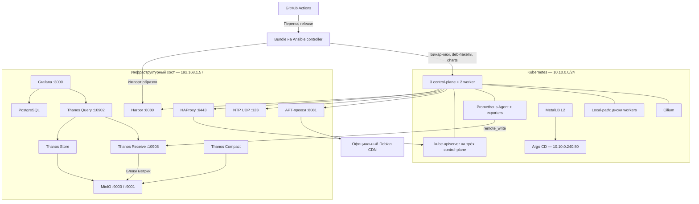

# Развёртывание Kubernetes в изолированной среде

Проект автоматизирует развёртывание Kubernetes на Debian 12 amd64 с помощью
kubeadm и Ansible. Стенд включает три узла control-plane, два worker и внешнюю
инфраструктуру на Docker Compose. GitHub Actions формирует переносимый комплект
бинарных файлов, Debian-пакетов, контейнерных образов и Helm charts. Установка
Kubernetes выполняется из этого комплекта; образы предоставляются локальным Harbor.

Тестовая среда эмулирует закрытый контур. APT-прокси передаёт запросы стандартных
Debian-пакетов в официальный репозиторий и требует доступа к Интернету со стороны
инфраструктурного хоста. Это не автономное зеркало Debian. При полностью
изолированном развёртывании используется внутренний APT-репозиторий либо
`apt_proxy_enabled=false`; зависимости Kubernetes устанавливаются из bundle.

## 1. Архитектура и адресация

Инфраструктура, Ansible controller и гипервизор размещены на Ubuntu-хосте
`192.168.1.57`. Виртуальные машины работают в NAT-сети libvirt `10.10.0.0/24`,
bridge `virbr-k8s`, шлюз `10.10.0.1`. Адреса VM задаются статически через cloud-init.
DHCP в этой сети отключён.



### Виртуальные машины

Параметры приведены по `deploy/infrastructure/vms/config.json`.

| Узел | IP | vCPU | RAM, ГиБ | Системный диск, ГиБ |
| --- | --- | --- | --- | --- |
| cp-01 | 10.10.0.11 | 2 | 2 | 15 |
| cp-02 | 10.10.0.12 | 2 | 2 | 15 |
| cp-03 | 10.10.0.13 | 2 | 2 | 15 |
| worker-01 | 10.10.0.21 | 3 | 3 | 20 |
| worker-02 | 10.10.0.22 | 3 | 3 | 20 |

Дополнительные диски не используются. Local-path создаёт локальные тома в
`/var/lib/k8s-storage` на системных дисках workers. Это provisioner, а не CSI-драйвер;
данные тома привязаны к узлу и не реплицируются.

### Внешние сервисы

| Компонент | Адрес | Назначение |
| --- | --- | --- |
| MinIO S3 API | http://192.168.1.57:9000 | Хранение блоков Thanos в bucket `thanos` |
| MinIO Console | http://192.168.1.57:9001 | Управление объектным хранилищем |
| Harbor | http://192.168.1.57:8080 | Интерфейс и registry контейнерных образов |
| APT-прокси | http://192.168.1.57:8081 | `/debian/` и `/debian-security/` |
| NTP | `192.168.1.57:123/udp` | Единый источник времени для VM |
| Kubernetes API | https://192.168.1.57:6443 | HAProxy перед тремя kube-apiserver |
| Grafana | http://192.168.1.57:3000 | Визуализация метрик |
| Thanos Query | http://192.168.1.57:10902 | Prometheus API и интерфейс запросов |
| Thanos Receive | http://192.168.1.57:10908/api/v1/receive | Приём remote_write |
| PostgreSQL, Thanos Store/Compact | Внутренняя сеть Compose | Служебные компоненты мониторинга |

Grafana хранит настройки, пользователей и дашборды в PostgreSQL. Метрики поступают
в Thanos Receive, затем блоками выгружаются в MinIO. Query объединяет текущие
данные Receive и историю через Store. Compact объединяет блоки и применяет
политики хранения: raw — 30 дней, 5 минут — 90 дней, 1 час — 365 дней.

HAProxy запускается до Kubernetes и предоставляет единый адрес API. MetalLB
обслуживает сервисы внутри Kubernetes и не заменяет HAProxy. Единственный
инфраструктурный хост остаётся общей точкой отказа стенда.

### Компоненты Kubernetes

| Компонент | Размещение | Назначение |
| --- | --- | --- |
| kube-apiserver, scheduler, controller-manager, etcd | Три control-plane | Управление кластером; stacked etcd |
| containerd, kubelet | Все узлы | Запуск контейнеров |
| Cilium, kube-proxy, CoreDNS | `kube-system` | Сеть pod’ов, сервисы и DNS |
| Local-path provisioner | `local-path-storage` | Default StorageClass `local-path` |
| MetalLB | `metallb-system` | L2-пул `10.10.0.240–10.10.0.250` |
| Prometheus Agent | `monitoring`, worker | Сбор метрик и отправка в Thanos; WAL PVC 2 ГиБ |
| node-exporter | Все узлы, `monitoring` | Метрики ОС |
| kube-state-metrics | `monitoring`, worker | Состояния объектов Kubernetes |
| Argo CD | `argocd`, workers | Последующее развёртывание приложений из Git |

Argo CD доступен по **http://10.10.0.240** через MetalLB, без NodePort.
Подсеть VM и этот адрес доступны непосредственно с Ubuntu-хоста. Для других
устройств требуется маршрутизация в `10.10.0.0/24`; адреса не принадлежат домашней
сети `192.168.1.0/24`. Пул MetalLB не должен пересекаться с адресами VM или DHCP.

## 2. Структура проекта

```text
config/                              версии, Debian-пакеты, mapping registry
.github/workflows/                   сборка release и проверка проекта
.github/scripts/                     загрузка, упаковка и проверка артефактов
deploy/infrastructure/               Compose и настройки внешних сервисов
  vms/config.json                    параметры VM и сети
  vms/vm/                            исходный Debian cloud image
  harbor/start.sh                    запуск официального установщика Harbor
deploy/ansible/                      плейбуки, inventory, tasks и templates
  files/create-vms.py                 реализация создания VM для Ansible
deploy/platform/charts/values/       параметры Cilium и Argo CD
deploy/scripts/                      распаковка bundle и импорт образов
release/                             скачанные assets GitHub Release
data/                                распакованный bundle
```

`release/`, `data/`, `.venv/`, локальные `.env`, inventory `hosts.yml` и qcow2
исключены из Git. Постоянные данные инфраструктуры и VM размещаются в абсолютном
каталоге `/stage`, независимо от расположения checkout.

## 3. Подготовка хоста и артефактов

Все команды инструкции выполняются **из корня репозитория**. Ansible вызывается
с явным inventory, поэтому смена рабочего каталога не требуется.

### 3.1. Требования к хосту

На Ubuntu-хосте необходимы Docker Engine с Compose v2, Python 3 с модулем venv,
`zstd`, OpenSSH client, KVM/libvirt, `virt-install`, `qemu-img` и `cloud-localds`.
Пользователь установки должен иметь доступ к Docker, `qemu:///system`, каталогу
`/stage/vms` и sudo для установщика Harbor. Для инфраструктуры требуется запас
RAM и диска сверх ресурсов VM; разреженные qcow2 растут по мере заполнения.

Подготовка окружения Ansible на машине с доступом к пакетам:

```bash
python3 -m venv .venv
.venv/bin/pip install 'ansible-core>=2.18,<2.20'
source .venv/bin/activate
sudo mkdir -p /stage
sudo install -d -o "$(id -un)" -g "$(id -gn)" -m 0750 /stage/vms
```

Для полностью изолированного controller зависимости подготавливаются заранее.
SSH-ключ пользователя, указанный в конфигурации VM, должен существовать.
Создание ключа при его отсутствии:

```bash
ssh-keygen -t ed25519
```

### 3.2. Образ Debian для VM

Исходный образ:
[Debian 12 genericcloud amd64 qcow2](https://cloud.debian.org/images/cloud/bookworm/latest/debian-12-genericcloud-amd64.qcow2).
Контрольные суммы: [SHA512SUMS](https://cloud.debian.org/images/cloud/bookworm/latest/SHA512SUMS).
После проверки образ размещается по пути:

```text
deploy/infrastructure/vms/vm/debian-12-genericcloud-amd64.qcow2
```

Cloud image позволяет задать сеть, пользователя и SSH-ключ через cloud-init.
Плейбук создания VM использует локальный файл и не скачивает образ.

### 3.3. GitHub Release и bundle

Workflow **Build offline bundle** запускается через `workflow_dispatch`.
Версии определяются в `config/versions.env`, список Debian-пакетов — в
`config/packages.txt`. Job загружает готовые upstream-артефакты и публикует release;
собственные контейнерные образы не собираются.

Bundle содержит kubeadm, kubelet, kubectl, containerd, runc, crictl, CNI plugins,
Helm, crane, Debian-пакеты с зависимостями, образы Kubernetes и дополнений,
Helm charts, манифесты, Compose-образы, установщик Harbor и контрольные суммы.
Список образов charts извлекается из результата `helm template`.

Все assets одного release размещаются в `./release`, включая `SHA256SUMS`,
`bundle-manifest.yaml`, `unpack-release.sh` и все части `.tar.zst`.
Checkout должен соответствовать commit release.

```bash
bash release/unpack-release.sh ./release ./data
bash deploy/scripts/verify-bundle.sh ./data
```

Распаковка проверяет контрольные суммы и обязательные файлы. При другом
расположении bundle плейбукам передаётся `-e data_dir=/absolute/path`.
Добавление Debian-пакетов выполняется изменением `config/packages.txt` и новой
сборкой release.

## 4. Запуск внешней инфраструктуры

Каждый компонент запускается отдельным Compose. Значения стенда заданы в файлах
конфигурации; адрес инфраструктурного хоста — `192.168.1.57`.

| Сервис | Пользователь | Начальный пароль |
| --- | --- | --- |
| MinIO | `minioadmin` | `Airgap2026!` |
| Grafana | `admin` | `Airgap2026!` |
| PostgreSQL Grafana | `grafana` | `Airgap2026!` |
| Harbor | `admin` | `Airgap2026!` |
| Debian VM, консоль | `deploy` | `Airgap2026!` |
| Argo CD | `admin` | Генерируется установкой; получение приведено в разделе 7.6 |

Это учётные данные учебного стенда. SSH к VM по умолчанию работает по ключу.
Пароли существующих баз и учётных записей не меняются простой заменой `.env`.

### 4.1. Загрузка инфраструктурных образов

Для хоста без доступа к registry образы загружаются из распакованного bundle:

```bash
while read -r image; do
  archive="$(printf '%s' "$image" | tr '/:@' '_').tar"
  docker load -i "data/repositories/registry/images/archives/$archive"
done < data/repositories/registry/images/groups/infrastructure.txt
```

При доступном registry Compose может загрузить образы самостоятельно.
Образы Harbor устанавливаются из его отдельного offline installer.

### 4.2. MinIO

```bash
docker compose -f deploy/infrastructure/minio/compose.yaml up -d
```

Одноразовый init-контейнер создаёт bucket `thanos`; его завершение с кодом `0`
является штатным. Данные хранятся в `/stage/minio`.
Используется образ MinIO из зеркала `cr.yandex/mirror/minio/minio`.

### 4.3. Внешний мониторинг

```bash
docker compose -f deploy/infrastructure/monitoring/compose.yaml up -d
```

MinIO должен быть доступен до запуска мониторинга. Compose запускает PostgreSQL,
Grafana и Thanos Receive, Store, Query, Compact. Данные размещаются в
`/stage/grafana` и `/stage/thanos`. Datasource **Thanos** и дашборд
**Airgap Kubernetes** загружаются автоматически. Метрики кластера появятся после
установки Prometheus Agent.

Для изменения настроек MinIO или мониторинга предусмотрены `.env.example`
в соответствующих каталогах. Копия `.env` размещается рядом с конкретным
Compose-файлом; общий `.env` в родительском `infrastructure` не используется.
При смене IP хоста изменяется `MINIO_ENDPOINT` в настройках мониторинга.

### 4.4. Harbor

```bash
sudo bash deploy/infrastructure/harbor/start.sh \
  192.168.1.57 \
  "$PWD/data/deploy/infrastructure/harbor/harbor-offline-installer-v2.15.4.tgz"
```

Аргументы: адрес хоста, путь к архиву, необязательный каталог установки.
Каталог по умолчанию — `/stage/harbor/installer/harbor`; он создаётся автоматически.
Скрипт вызывает официальный `install.sh` и создаёт public-проекты
`docker`, `ghcr`, `quay`, `k8s`, `charts`. Данные registry и БД размещаются в
`/stage/harbor/data`, журналы — в `/stage/harbor/log`.
Существующий `harbor.yml` сохраняется при повторном запуске.

### 4.5. HAProxy, APT и NTP

```bash
docker compose -f deploy/infrastructure/api-lb/compose.yaml up -d
docker compose -f deploy/infrastructure/apt/compose.yaml up -d
docker compose -f deploy/infrastructure/ntp/compose.yaml up -d
```

HAProxy направляет TCP-соединения с порта `6443` на три control-plane из
`deploy/infrastructure/api-lb/haproxy.cfg`. До запуска kube-apiserver недоступность
backend-серверов ожидаема.

APT-прокси не хранит зеркало и кэш пакетов. Nginx передаёт HTTP-запросы Debian
в официальный CDN. При установке нод Ansible заменяет APT sources на этот адрес.

NTP-контейнер Chrony использует готовый образ `cturra/ntp`, закреплённый digest,
и раздаёт время инфраструктурного хоста без изменения его часов. Источник
объявляется локальным со stratum 10. Корректность времени хоста проверяется через
`timedatectl status`; внешний UDP-порт `123` должен быть свободен.

### 4.6. Импорт образов и Helm-чартов

```bash
read -rsp 'Harbor password: ' harbor_password; echo
printf '%s' "$harbor_password" | ./data/tools/crane auth login \
  192.168.1.57:8080 --insecure --username admin --password-stdin
printf '%s' "$harbor_password" | ./data/tools/helm registry login \
  192.168.1.57:8080 --plain-http --username admin --password-stdin
unset harbor_password
bash deploy/scripts/import-images.sh --registry 192.168.1.57:8080 --insecure ./data
bash deploy/scripts/import-charts.sh --registry 192.168.1.57:8080 --plain-http ./data
```

Registry mapping: `docker.io → docker`, `ghcr.io → ghcr`, `quay.io → quay`,
`registry.k8s.io → k8s`. Имена repositories сохраняются, включая `library/`.
Containerd на нодах направляет запросы исходных registry в Harbor по HTTP.
Чарты Cilium, MetalLB и Argo CD загружаются из бандла в OCI-проект `charts`.
Ansible устанавливает их из Harbor с фиксированными версиями. В UI Harbor:
`Projects → charts → cilium / metallb / argo-cd` — артефакты и их версии.
Для уже установленного Harbor проект `charts` создаётся один раз как Public
через `Projects → New Project`; при новой установке его создаёт `start.sh`.

## 5. Создание VM и inventory

### 5.1. Конфигурация

Параметры задаются в `deploy/infrastructure/vms/config.json`.

| Поле | Назначение |
| --- | --- |
| `image` | Путь к qcow2 относительно каталога config |
| `directory` | Каталог дисков и cloud-init, по умолчанию `/stage/vms` |
| `infra_ip`, `ntp_server` | Адреса инфраструктуры и NTP |
| `network` | Имя сети, bridge, subnet, gateway и DNS |
| `defaults` | CPU, RAM, диск, пользователь, пароль, SSH-ключ |
| `nodes` | Список узлов, роли, адреса и переопределения defaults |
| `metallb_pool`, `argocd_ip` | Пул сервисов и адрес Argo CD |

Количество VM определяется списком `nodes`. Kubernetes-плейбуки рассчитаны на
три control-plane и один или более workers. Поля `cpu`, `ram_gib`, `disk_gib`,
`user`, `password`, `ssh_public_key`, `ssh_password_auth` могут переопределяться
для каждого узла. Изменение параметров существующей VM требует пересоздания.

### 5.2. Создание и проверка

```bash
ansible-playbook -i localhost, deploy/ansible/playbooks/create-vms.yml --check
ansible-playbook -i localhost, deploy/ansible/playbooks/create-vms.yml
cp /stage/vms/hosts.yml deploy/ansible/inventory/hosts.yml
virsh -c qemu:///system list --all
```

Плейбук выполняется локально, создаёт VM и сеть, включает autostart и формирует
inventory. Другой config передаётся через `-e vm_config_file=/absolute/path/config.json`.
При изменении адресов control-plane список backend-серверов HAProxy сверяется с
`/stage/vms/haproxy-backend.txt`; после изменения `haproxy.cfg` выполняется
`docker compose -f deploy/infrastructure/api-lb/compose.yaml restart`.

Повторный запуск создаёт новые и запускает остановленные VM, не заменяя их диски.
Полное пересоздание удаляет VM из текущего списка и их данные:

```bash
ansible-playbook -i localhost, deploy/ansible/playbooks/create-vms.yml -e vm_recreate=true -e vm_become=true --ask-become-pass
```

`vm_become=true` запускает операцию создания/пересоздания через sudo;
`--ask-become-pass` запрашивает пароль пользователя инфраструктурного хоста.
Это требуется для каталогов VM, принадлежащих root. Проверка конфигурации
выполняется от текущего пользователя. Права на удаление каталогов проверяются
до остановки VM.

Для восстановления создания, прерванного до регистрации VM, применяется
`-e vm_recover_incomplete=true`. Незавершённые каталоги сохраняются в резервную
копию `.incomplete-*`. После пересоздания обновляется inventory.

Для заранее предоставленных VM вместо создания используется копия
`deploy/ansible/inventory/ha.example.yml` в `hosts.yml` с фактическими адресами.
На VM требуются Debian 12 amd64, статическая сеть, Python 3, SSH и sudo.

### 5.3. Проверка SSH

Первое подключение сохраняет проверенные SSH host keys:

```bash
for ip in 10.10.0.11 10.10.0.12 10.10.0.13 10.10.0.21 10.10.0.22; do
  ssh "deploy@$ip" true
done
ansible -i deploy/ansible/inventory/hosts.yml all -m ping
```

Отпечатки сверяются с консолью VM перед подтверждением. После пересоздания
старый ключ удаляется командой `ssh-keygen -R <IP>`, новый проверяется повторно.
Результат Ansible для каждого узла — `SUCCESS` и `pong`.

## 6. Порядок выполнения Ansible

| Этап | Плейбук | Действие |
| --- | --- | --- |
| 1 | `create-vms.yml` | Создание тестовых VM, сети и inventory |
| 2 | `install-cluster.yml` | Проверка bundle, подготовка ОС, kubeadm init и join |
| 3 | `configure-cilium.yml` | Установка CNI и ожидание Ready всех узлов |
| 4 | `install-storage.yml` | Local-path и default StorageClass |
| 5 | `install-loadbalancer.yml` | MetalLB и L2-пул адресов |
| 6 | `install-monitoring.yml` | Prometheus Agent, node-exporter, kube-state-metrics |
| 7 | `install-argocd.yml` | Argo CD и внешний сервис MetalLB |

Следующий этап выполняется после успешного завершения предыдущего.
`prepare-nodes.yml` входит в `install-cluster.yml` и отдельно не требуется.

## 7. Установка Kubernetes и дополнений

### 7.1. Установка кластера

```bash
ansible-playbook -i deploy/ansible/inventory/hosts.yml deploy/ansible/playbooks/install-cluster.yml
```

Плейбук последовательно вызывает:

1. `verify-data.yml`: проверка bundle на controller без sudo.
2. `prepare-nodes.yml`: настройка APT sources, перенос `.deb` и бинарников,
   установка зависимостей, настройка Chrony, containerd, kubelet, swap и sysctl.
3. `init-control-plane.yml`: `kubeadm init` на cp-01.
4. `join-control-planes.yml`: присоединение cp-02 и cp-03.
5. `join-workers.yml`: присоединение workers.

APT sources сохраняются в `/etc/apt/airgap-source-backup`. Установка зависимостей
из bundle использует `apt-get --no-download`, отключённые sources и каталог
переданных `.deb` в качестве кэша. Разрешена замена `systemd-timesyncd` на Chrony;
остальные удаления пакетов отклоняются предварительной проверкой.
Обычные последующие APT-запросы используют локальный прокси.

Артефакты копируются в `/opt/k8s-airgap`; Helm и charts размещаются на cp-01.
До установки CNI состояния `NotReady` у нод и `Pending` у CoreDNS ожидаемы.
Повторный запуск не выполняет `kubeadm reset`; плейбуки предназначены для
первичного развёртывания, а не обновления версии существующего кластера.

### 7.2. Cilium и доступ с controller

```bash
ansible-playbook -i deploy/ansible/inventory/hosts.yml deploy/ansible/playbooks/configure-cilium.yml
```

Cilium работает в VXLAN mode с kube-proxy. Плейбук ожидает Ready всех узлов.
Копирование административного kubeconfig на хост:

```bash
mkdir -p "$HOME/.kube"
chmod 700 "$HOME/.kube"
ansible -i deploy/ansible/inventory/hosts.yml 'control_plane[0]' -b -m ansible.builtin.fetch \
  -a "src=/etc/kubernetes/admin.conf dest=$HOME/.kube/airgap.conf flat=true"
chmod 600 "$HOME/.kube/airgap.conf"
export KUBECONFIG="$HOME/.kube/airgap.conf"
export PATH="$PWD/data/tools:$PATH"
kubectl get nodes -o wide
```

Конфиг содержит адрес API `https://192.168.1.57:6443` и права администратора.
Существующий `~/.kube/config` не заменяется. В новом терминале переменные
`KUBECONFIG` и `PATH` задаются повторно из корня проекта.
Для установленного на хосте k9s:

```bash
k9s --kubeconfig "$HOME/.kube/airgap.conf"
```

### 7.3. Локальное хранилище

```bash
ansible-playbook -i deploy/ansible/inventory/hosts.yml deploy/ansible/playbooks/install-storage.yml
kubectl get storageclass
kubectl -n local-path-storage get pods
```

StorageClass `local-path` назначается default. Режим `WaitForFirstConsumer`
создаёт том после назначения использующего его pod на узел.

### 7.4. MetalLB

```bash
ansible-playbook -i deploy/ansible/inventory/hosts.yml deploy/ansible/playbooks/install-loadbalancer.yml
kubectl -n metallb-system get pods,ipaddresspools,l2advertisements
```

Плейбук устанавливает MetalLB и настраивает L2Advertisement для пула из inventory.
Сервисы приложений могут получать отдельные адреса через тип `LoadBalancer`.

### 7.5. Мониторинг

```bash
ansible-playbook -i deploy/ansible/inventory/hosts.yml deploy/ansible/playbooks/install-monitoring.yml
kubectl -n monitoring get pods,pvc
curl -fsSG http://192.168.1.57:10902/api/v1/query \
  --data-urlencode 'query=up{cluster="airgap"}'
```

Prometheus Agent собирает метрики ОС, kubelet/cAdvisor и kube-state-metrics,
отправляя их в `thanos_remote_write_url`. WAL хранится на PVC размером 2 ГиБ;
максимальное время удержания — 24 часа. Потеря тома или длительная недоступность
Receive может привести к потере ещё не отправленных метрик.

Дашборд [Airgap Kubernetes](http://192.168.1.57:3000/d/airgap) содержит 18 панелей:
состояния нод и pod’ов, CPU/RAM, диски, сеть, рестарты, наиболее ресурсоёмкие pod’ы
и requests относительно allocatable. JSON находится в
`deploy/infrastructure/monitoring/dashboards/cluster.json` и загружается Grafana
автоматически. Метрики в Grafana подтверждают путь Agent → Receive → Query;
блоки в MinIO после закрытия подтверждают работу долговременного хранения.

Дополнительный каталоговый вариант:
[Kubernetes / Views / Global — Grafana Labs, ID 15757](https://grafana.com/grafana/dashboards/15757-kubernetes-views-global/).
Импорт выполняется через **Dashboards → New → Import**, datasource — **Thanos**.
Для закрытой сети используется заранее скачанный JSON. Этот дашборд рассчитан
на kube-prometheus-stack; запросы и labels могут потребовать адаптации.

### 7.6. Argo CD

```bash
ansible-playbook -i deploy/ansible/inventory/hosts.yml deploy/ansible/playbooks/install-argocd.yml
kubectl -n argocd get pods,svc
kubectl -n argocd get secret argocd-initial-admin-secret \
  -o jsonpath='{.data.password}' | base64 -d
printf '\n'
```

Интерфейс: **http://10.10.0.240**, пользователь `admin`, пароль — из секрета выше.
Поды должны иметь статус Running и готовность всех контейнеров, сервис
`argocd-public` — EXTERNAL-IP `10.10.0.240`. Сервис опубликован по HTTP на порту 80
с отключённой выдачей NodePorts. После первого входа начальный пароль изменяется.

Проверка HTTP с инфраструктурного хоста:

```bash
curl --noproxy '*' -I http://10.10.0.240
```

Успешный вход подтверждает доступность интерфейса; первое приложение со статусами
`Synced` и `Healthy` подтверждает полный цикл развёртывания.
Последующие приложения устанавливаются через Argo CD. В закрытом контуре для
этого необходим доступный Git-репозиторий и образы приложений в Harbor.

## 8. Демонстрация GitOps и отчётные материалы

Демо-приложение размещается в этом же репозитории, каталог
`deploy/argocd/apps/airgap-demo`. Argo CD отслеживает только этот путь в ветке `main`.
В модели закрытого контура предполагается доступный внутренний Git, в том числе
приватный; для демонстрации его роль выполняет GitHub-репозиторий
`https://github.com/bralbral/k8s-airgap.git`. Учётные данные приватного репозитория
регистрируются в Argo CD вне Git. Это допущение требует доступа Argo CD к GitHub
и не означает полной сетевой изоляции.

После публикации новых манифестов в `main`:

```bash
kubectl apply -f deploy/argocd/airgap-demo.yaml
kubectl -n argocd get application airgap-demo -w
```

Ожидаемый результат — `Synced / Healthy`. Приложение содержит две реплики BusyBox
HTTP, ConfigMap с HTML и сервис MetalLB **http://10.10.0.241**. Образ уже входит
в bundle; манифесты приложения применяет Argo CD. Команда выше регистрирует
только AppProject и Application. Доступ к странице предусмотрен с хоста стенда.

| Материал | Содержание |
| --- | --- |
| [Демо-приложение](docs/demo.md) | Установка, проверка и изменение v1 → v2 через Git |
| [Презентация PowerPoint](docs/presentation/k8s-airgap.pptx) | 14 слайдов с архитектурой и заметками докладчика |
| [Презентация PDF](docs/presentation/k8s-airgap.pdf) | Версия для просмотра и показа |
| [Сценарий видео](docs/video-script.md) | Очистка стенда, установка инфраструктуры и кластера с нуля, проверки |

Исходник презентации — `docs/presentation/build.py`; генерация требует
`python-pptx`. Запись видео выполняется отдельно по сценарию, готовый ролик
не входит в репозиторий.

## 9. Эксплуатация и проверка проекта

Docker и libvirt должны запускаться автоматически. У инфраструктурных сервисов
заданы restart policies, у VM и виртуальной сети — autostart. Проверка после
перезагрузки хоста:

```bash
docker compose ls --all
virsh -c qemu:///system list --all
kubectl --kubeconfig "$HOME/.kube/airgap.conf" get nodes
```

Повторный запуск отдельного Compose сохраняет данные в `/stage`:

```bash
docker compose -f deploy/infrastructure/monitoring/compose.yaml up -d
docker compose -f deploy/infrastructure/monitoring/compose.yaml ps
docker compose -f deploy/infrastructure/monitoring/compose.yaml logs --tail=100
```

Harbor управляется сгенерированным официальным Compose:

```bash
sudo docker compose -f /stage/harbor/installer/harbor/docker-compose.yml up -d
sudo docker compose -f /stage/harbor/installer/harbor/docker-compose.yml ps
```

При ошибке подключения к syslog `127.0.0.1:1514` сначала запускается сервис `log`:

```bash
sudo docker compose -f /stage/harbor/installer/harbor/docker-compose.yml up -d log
```

После готовности логгера повторяется запуск всего Harbor. Повторная установка
из архива для обычного перезапуска не требуется.

Проверка репозитория без загрузки upstream-артефактов:

```bash
# Требуются ansible-core, PyYAML, Jinja2, yamllint, shellcheck и zstd.
source .venv/bin/activate
.github/scripts/validate.sh
```

Проверка охватывает shell/YAML, согласованность версий, Compose, Ansible syntax,
рендеринг манифестов и упаковку/распаковку тестового release с контролем повреждений.
Полная загрузка upstream-артефактов проверяется workflow сборки bundle.
