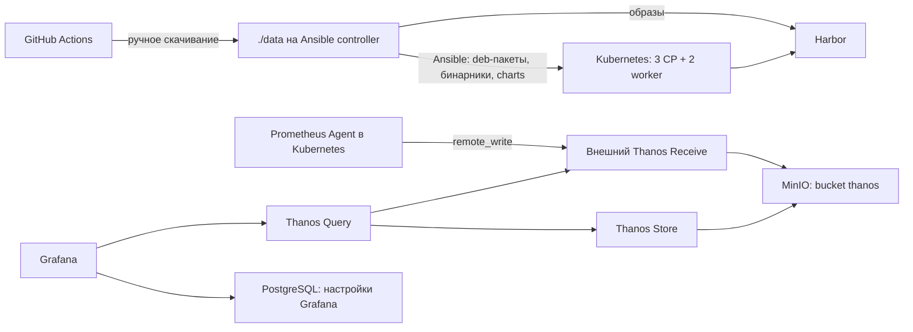

# Kubernetes offline: Debian 12, kubeadm, 3 control-plane + 2 worker

Стенд разворачивается на **пяти предоставленных VM**. На каждой — Debian 12
amd64. Создание виртуалок не автоматизируется. Kubernetes ставится через
`kubeadm` из бинарников, которые GitHub Actions скачивает в переносимый release.
Ты скачиваешь release вручную, распаковываешь в `./data`, Ansible копирует
нужные файлы на машины. На нодах не требуется доступ в Интернет.

## 1. Что и где работает

| Место | Компоненты |
| --- | --- |
| Внешний infrastructure-host | APT-прокси, MinIO, Harbor, HAProxy, Grafana + PostgreSQL, Thanos Receive / Query / Store / Compact |
| 3 control-plane VM | kube-apiserver, scheduler, controller-manager, stacked etcd, kubelet, containerd, Cilium |
| 2 worker VM | приложения, local-path-provisioner, Prometheus Agent, kube-state-metrics, Argo CD |
| Все Kubernetes VM | node-exporter; MetalLB speaker |
| Ansible controller | checkout репозитория, Ansible, вручную скачанный `./data` |

Infrastructure-host и Ansible controller можно совместить. Внешние сервисы
не занимают память пяти Kubernetes VM. Для infrastructure-host нужен отдельный
запас RAM и диска под Harbor, MinIO и мониторинг; лимиты VM ниже к нему не относятся.



Grafana не принимает метрики и не хранит их в PostgreSQL. PostgreSQL хранит
пользователей, настройки и дашборды Grafana. Prometheus работает **в Agent mode**:
собирает метрики, буферизует их в WAL и отправляет во внешний Thanos Receive.
Receive пишет текущие данные на диск и выгружает блоки в MinIO. Query объединяет
свежие данные Receive и историю из Store; Compact обслуживает блоки в bucket.

Структура:

```text
config/                         версии, Debian-пакеты, registry mapping
.github/workflows/              проверка и сборка переносимого release
.github/scripts/                только код сборки и проверки release
deploy/infrastructure/apt/       HTTP-прокси официального Debian без кэша
deploy/infrastructure/vms/       создание VM и конфиг стенда
deploy/infrastructure/minio/     отдельный Compose с MinIO из зеркала Яндекса
deploy/infrastructure/harbor/    start.sh → официальный install.sh
deploy/infrastructure/api-lb/    HAProxy для Kubernetes API
deploy/infrastructure/monitoring/ Grafana, PostgreSQL, Thanos
deploy/ansible/                  inventory, плейбуки и шаблоны
deploy/platform/charts/values/  настройки Cilium и Argo CD
deploy/scripts/                 распаковка, проверка, импорт образов
```

Нет собственного Dockerfile и сборки образов, Vault, NFS CSI, cert-manager,
Traefik или Kubernetes-дистрибутива поверх kubeadm. Для локального стенда есть
отдельный скрипт создания VM через KVM/libvirt.

Порядок автоматизации в `deploy/ansible/playbooks/` начинается с `create-vms.yml`:
он подготавливает тестовые VM. Затем запускаются `install-cluster.yml` и отдельные
плейбуки CNI, storage, MetalLB, мониторинга и Argo CD, описанные ниже.
`deploy/infrastructure/` содержит Compose и настройки внешних сервисов.

## 2. Адреса и предоставленные VM

Пример единой L2-сети `10.10.0.0/24`:

| Имя | Статический IP | vCPU | RAM | Диск |
| --- | --- | --- | --- | --- |
| infrastructure-host | 10.10.0.5 | отдельно | отдельно | `/stage` с запасом под артефакты и метрики |
| cp-01 | 10.10.0.11 | 2 | 2 ГиБ | системный, например 30 ГиБ |
| cp-02 | 10.10.0.12 | 2 | 2 ГиБ | системный, например 30 ГиБ |
| cp-03 | 10.10.0.13 | 2 | 2 ГиБ | системный, например 30 ГиБ |
| worker-01 | 10.10.0.21 | 3 | 4 ГиБ | системный, например 60 ГиБ |
| worker-02 | 10.10.0.22 | 3 | 4 ГиБ | системный, например 60 ГиБ |
| MetalLB pool | 10.10.0.240–10.10.0.250 | — | — | исключить из DHCP |
| Argo CD | 10.10.0.240 | — | — | адрес из MetalLB pool |

Дополнительные диски не нужны. Это небольшой стенд: control-plane taints
сохраняются, приложения размещаются на workers. Local-path использует
`/var/lib/k8s-storage` на системных дисках. Это provisioner для PVC, **не CSI-драйвер**;
том привязан к узлу и не реплицируется. Потеря worker не переносит его данные
на второй worker. Следи за свободным местом, чтобы тома не забили системный диск.

До Ansible на каждой VM должны быть:

1. Debian 12 amd64 с уникальными hostname, MAC и machine-id.
2. Статический IP, доступный controller и другим VM.
3. SSH, Python 3, sudo; пользователь `deploy` с SSH-ключом и sudo.
4. Внутренний источник времени; пример inventory использует `10.10.0.1`.
5. Корректное время. В плейбуке chrony переключается на `ntp_server`.

Статику задай в гипервизоре/cloud-init при подготовке VM либо внутри гостя.
Для Debian с **ifupdown** пример `/etc/network/interfaces.d/ens3` на cp-01:

```text
auto ens3
iface ens3 inet static
    address 10.10.0.11/24
    gateway 10.10.0.1
```

Имя интерфейса проверь через `ip -br link`. На остальных VM замени адрес по таблице.
Убери конкурирующую DHCP-конфигурацию этого интерфейса. Если сеть управляется
cloud-init, NetworkManager или systemd-networkd, задай эти же параметры в нём.
Применяй изменения через консоль гипервизора, чтобы не потерять SSH. Адрес в
inventory сам по себе **не настраивает** IP гостевой системы.

### Поднять тестовый стенд с виртуалками

Если готовых VM нет, используй скрипт `deploy/infrastructure/vms/create.sh`.
Он запускает Ansible-плейбук `deploy/ansible/playbooks/create-vms.yml`,
который создаёт виртуальную сеть и Debian VM на локальном KVM/libvirt.
После этого Kubernetes устанавливается отдельно через Ansible.

**Шаг 1. Подготовь образ.**

Всё для создания VM лежит в `deploy/infrastructure/vms/`:

```text
vms/
  create.sh       короткий запуск Ansible-плейбука
  config.json     параметры сети, пользователей и список VM
  vm/             сюда положи скачанный qcow2
```

Нужны KVM/libvirt, `virt-install`, `qemu-img`, `cloud-localds`, Python 3
и `ansible-core` (как для установки Kubernetes). Дополнительные Ansible collections
не нужны. Для общего окружения Ansible из корня проекта:

```bash
python3 -m venv .venv
.venv/bin/pip install 'ansible-core>=2.18,<2.20'
source .venv/bin/activate
```

Это подготовка controller на машине с Интернетом; в закрытый контур окружение
и зависимости нужно подготовить заранее. На текущем стенде `.venv` уже подготовлено.
`create.sh` найдёт Ansible в PATH или в `.venv` проекта. Для прямых команд
`ansible-playbook` активируй окружение.
Скачай [Debian 12 genericcloud amd64 qcow2](https://cloud.debian.org/images/cloud/bookworm/latest/debian-12-genericcloud-amd64.qcow2)
в `deploy/infrastructure/vms/vm/debian-12-genericcloud-amd64.qcow2`.
Проверь [SHA512SUMS](https://cloud.debian.org/images/cloud/bookworm/latest/SHA512SUMS).
Используй исходный cloud image, не диск уже установленной VM. Скрипт ничего
не скачивает и не устанавливает через Интернет. Образ исключён из Git и bundle.

**Шаг 2. Задай параметры в `deploy/infrastructure/vms/config.json`.**

Готовый конфиг уже есть в репозитории. Например, настройки для пяти VM:

```json
{
  "image": "vm/debian-12-genericcloud-amd64.qcow2",
  "directory": "/stage/vms",
  "infra_ip": "192.168.1.57",
  "ntp_server": "10.10.0.1",
  "network": {
    "name": "k8s-lab",
    "bridge": "virbr-k8s",
    "subnet": "10.10.0.0/24",
    "gateway": "10.10.0.1",
    "dns": ["10.10.0.1"]
  },
  "metallb_pool": "10.10.0.240-10.10.0.250",
  "argocd_ip": "10.10.0.240",
  "defaults": {
    "user": "deploy",
    "password": "Airgap2026!",
    "ssh_public_key": "~/.ssh/id_ed25519.pub",
    "ssh_password_auth": false,
    "cpu": 2,
    "ram_gib": 2,
    "disk_gib": 30
  },
  "nodes": [
    {"name": "cp-01", "role": "control_plane", "ip": "10.10.0.11"},
    {"name": "cp-02", "role": "control_plane", "ip": "10.10.0.12"},
    {"name": "cp-03", "role": "control_plane", "ip": "10.10.0.13"},
    {"name": "worker-01", "role": "workers", "ip": "10.10.0.21", "cpu": 3, "ram_gib": 4, "disk_gib": 60},
    {"name": "worker-02", "role": "workers", "ip": "10.10.0.22", "cpu": 3, "ram_gib": 4, "disk_gib": 60}
  ]
}
```

`defaults` задаёт общие параметры. Поля в конкретной записи `nodes` имеют
приоритет: в примере workers получают больше CPU, RAM и диска.
Количество VM определяется количеством записей в `nodes`, отдельного счётчика нет.
Перед запуском проверь `infra_ip`, путь к SSH-ключу и `ntp_server` для своего стенда.

**Шаг 3. Проверь конфиг и создай VM.**

Из корня проекта:

```bash
# Если SSH-ключа ещё нет (под обычным пользователем):
ssh-keygen -t ed25519

cd deploy/infrastructure/vms
bash create.sh --check
bash create.sh
```

То же самое напрямую через Ansible, из корня проекта:

```bash
# Только проверка настроек, без изменения VM:
ansible-playbook -i localhost, deploy/ansible/playbooks/create-vms.yml --check
# Создать новые VM / запустить существующие:
ansible-playbook -i localhost, deploy/ansible/playbooks/create-vms.yml
# Полностью пересоздать VM, удалив их диски:
ansible-playbook -i localhost, deploy/ansible/playbooks/create-vms.yml -e vm_recreate=true
# Восстановить прерванное создание с резервной копией:
ansible-playbook -i localhost, deploy/ansible/playbooks/create-vms.yml -e vm_recover_incomplete=true
```

Другой конфиг: `-e vm_config_file=/absolute/path/config.json`.
Плейбук выполняется **на localhost**, SSH-доступ к ещё не созданным VM не нужен.
Текущий пользователь должен иметь доступ к `qemu:///system` и каталогу `/stage/vms`;
на этом стенде пользователь `ubuntu` уже входит в группу `libvirt`.
Логика проверки принадлежности VM и безопасного удаления сохранена в helper
`deploy/ansible/files/create-vms.py`; Ansible вызывает его и показывает
результат как `ok` или `changed`. Kubernetes автоматически не устанавливается.

Скрипт сам прочитает соседний `config.json` и возьмёт образ из указанного там
пути `vm/…`. Диски VM и сгенерированные конфиги появятся в `/stage/vms`.

`~` в пути к SSH-ключу относится к пользователю, вызвавшему sudo.
Относительный путь к образу или ключу считается от каталога файла конфигурации.
Другой конфиг можно передать аргументом: `bash create.sh /path/to/config.json`.
`--check` проверяет настройки без создания VM и без вывода паролей.

В `config.json`:

| Поле | Что меняет |
| --- | --- |
| `image` | Путь к исходному qcow2, по умолчанию `vm/debian-12-genericcloud-amd64.qcow2` |
| `directory` | Каталог дисков и cloud-init, по умолчанию `/stage/vms` |
| `infra_ip` | IP Harbor, HAProxy и Thanos для генерируемого inventory |
| `network` | Имя NAT-сети, bridge, подсеть, шлюз и DNS; DHCP выключен |
| `defaults` | Общие CPU, `ram_gib`, `disk_gib`, пользователь, пароль и SSH-ключ |
| `nodes` | Список VM: имя, роль, IP и переопределения общих настроек |
| `metallb_pool`, `argocd_ip` | Адреса сервисов, исключённые из адресов VM |
| `ntp_server` | Доступный внутренний сервер времени для Ansible |

По умолчанию создаются три control-plane (2 CPU / 2 ГиБ / 30 ГиБ)
и два worker (3 CPU / 4 ГиБ / 60 ГиБ). Чтобы добавить worker, добавь объект в `nodes`:

```json
{"name": "worker-03", "role": "workers", "ip": "10.10.0.23", "cpu": 4, "ram_gib": 8, "disk_gib": 80}
```

Любая нода может переопределить `user`, `password`, `ssh_public_key`,
`ssh_password_auth` и ресурсы. Пользователь по умолчанию — `deploy`, пароль —
`Airgap2026!`. Пароль работает в консоли VM; SSH по умолчанию только по ключу.
Для SSH по паролю установи `ssh_password_auth: true`; если ключ не нужен,
укажи `ssh_public_key: null`. Для Ansible тогда используй `--ask-pass`
(на controller может понадобиться `sshpass`). `password: null` отключает пароль.
Пользователь получает sudo без пароля. Пароли в inventory не записываются.

Повторный запуск создаёт добавленные VM и запускает выключенные существующие.
Существующие VM **не пересоздаются**: изменение их ресурсов, пароля или сети
вызывает понятную ошибку, а не перезапись диска. Изменения в конфиге применяются
при создании новой VM; удаление записи не удаляет саму VM или её диск.
Для полного пересоздания VM из текущего `nodes`:

```bash
bash create.sh --recreate
```

**Это удалит эти VM и их диски, включая Kubernetes и все данные внутри.**
После удаления скрипт создаст их по текущим настройкам `config.json`.
Удаляются только VM из текущего списка, проверенные как созданные этим скриптом,
и их каталоги. Остальные VM, резервные каталоги `.incomplete-*`, исходный образ
и общая сеть сохраняются. Флаг не требует дополнительного подтверждения.
Если в конфиге изменены сеть или её подсеть, сначала восстанови прежние параметры:
`--recreate` пересоздаёт VM, а не сеть. После пересоздания SSH host keys изменятся.

Если создание прервано до регистрации VM, можно изменить конфиг и продолжить:

```bash
bash create.sh --recover-incomplete
```

Незавершённые каталоги будут сохранены рядом с именем `имя.incomplete-дата`,
затем VM создадутся по текущим настройкам. Зарегистрированные VM этот флаг
не заменяет. Резервные копии занимают место на диске.

После изменения списка нод скопируй обновлённый inventory.
Kubernetes-плейбуки рассчитаны на три control-plane и один или более workers;
VM-скрипт сам Kubernetes не устанавливает и новые ноды в кластер не присоединяет.

Диски независимые, разреженные qcow2. По умолчанию их максимальный суммарный
размер — 210 ГиБ; на текущем хосте свободно около 65 ГиБ. Контролируй фактический
рост дисков. Для VM и сети включён autostart.

**Шаг 4. Проверь VM и передай inventory в Ansible.**

```bash
virsh -c qemu:///system list --all
ssh deploy@10.10.0.11 'cloud-init status --wait'
```

Inventory и список backend-серверов HAProxy создаются в каталоге VM:
`/stage/vms/hosts.yml` и `/stage/vms/haproxy-backend.txt`.
Из корня проекта (сохрани свой inventory, если он уже есть):

```bash
cp /stage/vms/hosts.yml deploy/ansible/inventory/hosts.yml
cd deploy/ansible
ansible all -m ping
```

При смене IP control-plane обнови блок backend в
`deploy/infrastructure/api-lb/haproxy.cfg` по сгенерированному списку и перезапусти HAProxy.
До первого Ansible-подключения подтверди SSH host keys VM. Скрипт не отключает
проверку ключей. Внутренний NTP должен работать по адресу из `ntp_server`:
скрипт не устанавливает сервер времени на хост.

В NAT-сети VM и MetalLB доступны с Ubuntu-хоста. Доступ с других устройств
домашней сети настраивается отдельно.

### Сеть без NodePort

- `10.10.0.5:6443` — HAProxy перед API всех трёх control-plane.
- MetalLB L2 выдаёт отдельные IP сервисам типа `LoadBalancer`.
- Argo CD доступен на `http://10.10.0.240`, без ingress и без NodePort.
- Grafana — на infrastructure-host: `http://10.10.0.5:3000`.

HAProxy нужен до Kubernetes; MetalLB его не заменяет. Один infrastructure-host
остаётся единой точкой отказа API endpoint и внешней инфраструктуры. Три
control-plane защищают от отказа одной CP VM, но не от отказа HAProxy-хоста.

Для стенда разреши между VM внутренний трафик; в частности TCP 6443, 10250,
между CP TCP 2379–2380, Cilium VXLAN UDP 8472 и health TCP 4240, MetalLB memberlist
TCP/UDP 7946. От нод к infrastructure-host нужны TCP 8080, 8081, 10908;
к внутреннему NTP — UDP 123. Для MetalLB сеть гипервизора должна пропускать
ARP-анонсы service IP: port security/anti-spoofing не должны их блокировать.
Пользователям нужен маршрут в эту сеть. Публичный NodePort-диапазон не открывается.

## 3. Внешняя инфраструктура

Единый пароль стенда: `Airgap2026!` — MinIO, Grafana, PostgreSQL,
администратор Harbor и его встроенная БД. Thanos использует этот же пароль
как secret key MinIO.

На infrastructure-host заранее установи Docker Engine и Compose v2.
Все команды ниже выполняются из корня checkout. Каждый сервис запускается
своим Compose. Данные — только в **абсолютном `/stage`**, не в `./stage`.
Исходные конфиги остаются в checkout, слои образов и Docker logs — в хранилище
самого Docker. Контейнеры сами создают подкаталоги данных; `/stage` уже подготовлен.

При наличии Интернета Compose скачает образы. Для полностью
закрытого infrastructure-host сначала перенеси release и загрузи его
инфраструктурные образы по разделу 5. Не запускай `pull` в закрытом контуре.

Порядок запуска инфраструктуры:

1. **MinIO** — запусти Compose; одноразовый контейнер `init` автоматически создаст bucket `thanos`.
2. **Мониторинг** — запусти Compose с Thanos, PostgreSQL и Grafana. Ему уже нужен MinIO; до установки Kubernetes-агента графики будут пустыми.
3. **Harbor** — настрой и запусти официальный установщик, создай проекты и загрузи образы из bundle перед установкой Kubernetes.
4. **HAProxy** — запусти балансировщик Kubernetes API перед запуском kubeadm. Backend-серверы станут доступны после поднятия control plane.

5. **APT-прокси** — запусти перед `prepare-nodes`: он обслуживает обычные Debian-пакеты.

Harbor и HAProxy не зависят от мониторинга; здесь указан единый порядок для стенда.
Подробные команды — ниже, в том же порядке.

### 3.1. MinIO

Используется образ `cr.yandex/mirror/minio/minio:RELEASE.2023-08-09T23-30-22Z`, закреплённый в Compose по тегу.
Он включается в инфраструктурные образы bundle; отдельный архив MinIO не нужен.

```bash
cp deploy/infrastructure/minio/.env.example deploy/infrastructure/minio/.env
docker compose -f deploy/infrastructure/minio/compose.yaml up -d
```

S3 API: `http://10.10.0.5:9000`, веб-интерфейс: `http://10.10.0.5:9001`.
Контейнер `init` ждёт готовности MinIO, создаёт bucket `thanos` и завершается.
Если bucket уже существует, данные сохраняются. Образ `amazon/aws-cli` включён
в bundle для офлайн-запуска. Перед запуском мониторинга проверь результат:

```bash
docker compose -f deploy/infrastructure/minio/compose.yaml logs init
docker compose -f deploy/infrastructure/minio/compose.yaml ps -a
```

У `init` должен быть статус `Exited (0)`. Данные MinIO: `/stage/minio`.

### 3.2. Grafana + PostgreSQL + Thanos

Сначала должны работать MinIO и bucket `thanos`.

```bash
cp deploy/infrastructure/monitoring/.env.example deploy/infrastructure/monitoring/.env
# Проверь адрес MinIO; пароли для стенда уже заданы.
docker compose -f deploy/infrastructure/monitoring/compose.yaml up -d
```

| Компонент | Адрес / каталог |
| --- | --- |
| Grafana | http://10.10.0.5:3000, пользователь `admin` |
| Thanos Query | http://10.10.0.5:10902 |
| Thanos Receive remote_write | http://10.10.0.5:10908/api/v1/receive |
| Grafana PostgreSQL | только внутри Compose, `/stage/grafana/postgres` |
| Grafana files | `/stage/grafana/data` |
| Thanos Receive / Store / Compact | `/stage/thanos/{receive,store,compact}` |
| Долговременные блоки метрик | MinIO, bucket `thanos` |

Источник `Thanos` и дашборд **Airgap Kubernetes** создаются автоматически,
импорт из Интернета не нужен. До установки агента в Kubernetes графики будут пустыми.
Receive хранит локально последние 24 часа; выгрузка блоков в MinIO не мгновенная,
обычно после закрытия двухчасового блока. Query показывает и свежие данные.
Retentions Compact: raw 30 дней, 5-minute 90 дней, 1-hour 365 дней.

### 3.3. Harbor — штатный установщик

Скачай официальный offline installer. На infrastructure-host нужны Docker,
Compose и Python 3. Скрипт принимает два обязательных аргумента: IP/hostname
и путь к архиву. Например, из папки `deploy/infrastructure/harbor`:

```bash
sudo bash start.sh 192.168.1.57 ./harbor-offline-installer-v2.15.4.tgz
```

Третий аргумент — необязательный каталог установки. По умолчанию:
`/stage/harbor/installer/harbor`. Отсутствующий каталог скрипт создаёт автоматически,
распаковывает туда архив, создаёт `harbor.yml` из официального шаблона
и запускает штатный `install.sh`. Пример с другим каталогом:

```bash
sudo bash start.sh 192.168.1.57 ./harbor-offline-installer-v2.15.4.tgz /stage/harbor/custom-installer
```

Адрес: `http://<IP>:8080`, логин `admin`, пароль `Airgap2026!`.
Пароль встроенной БД также `Airgap2026!`. Данные: `/stage/harbor/data`,
логи: `/stage/harbor/log`; третий аргумент меняет только расположение установщика
и конфигов. HTTPS для этого стенда отключён.

Повторный запуск сохраняет существующий `harbor.yml` и пароли. Начальный пароль
администратора применяется только при первой установке Harbor.

Harbor создаёт свой Compose. Управление им:

```bash
cd /stage/harbor/installer/harbor
sudo docker compose ps
sudo docker compose down
sudo docker compose up -d
```

В `http://<IP>:8080` войди как `admin` и вручную создай **public projects**:
`docker`, `ghcr`, `quay`, `k8s`. Это обычные проекты для импортированных образов,
не proxy cache: ноды не должны обращаться во внешние registries.

### 3.4. HAProxy

HAProxy предоставляет единый адрес Kubernetes API и передаёт TCP-соединения
на доступные API-серверы трёх control-plane нод. Балансировщик перед API-серверами
описан в [документации kubeadm](https://kubernetes.io/docs/setup/production-environment/tools/kubeadm/high-availability/).
Это адрес для `kubectl`, подключения нод и других клиентов API.

В стенде используется **один HAProxy на infrastructure-host — единая точка отказа**.
Три control-plane ноды не устраняют эту зависимость. При отказе HAProxy или его
хоста общий endpoint API станет недоступен; уже запущенные приложения могут
продолжить работать, но управление кластером через этот endpoint нарушится.
Для отказоустойчивого входа в API нужны, например, два HAProxy на разных хостах
с Keepalived и общим виртуальным IP либо внешний отказоустойчивый балансировщик.
В текущем стенде это не настроено.

Запусти HAProxy **перед установкой Kubernetes через Ansible**:

1. В `deploy/infrastructure/api-lb/haproxy.cfg` укажи реальные IP трёх master-VM.
   Сейчас `10.10.0.11–13` — примеры; порт каждого API-сервера — `6443`.
2. В Ansible inventory задай `control_plane_endpoint` как адрес infrastructure-host
   с портом `6443`. Для текущего стенда: `192.168.1.57:6443`.
3. Из корня проекта выполни:

```bash
docker compose -f deploy/infrastructure/api-lb/compose.yaml up -d
```

HAProxy публикует порт `6443` хоста. Его можно запустить и до готовности VM:
пока kube-apiserver не установлен, сообщения о недоступных backend-серверах ожидаемы.
Перед запуском Ansible реальные адреса master-VM должны быть настроены.
После изменения `haproxy.cfg` перезапусти сервис:

```bash
docker compose -f deploy/infrastructure/api-lb/compose.yaml restart haproxy
```

### 3.5. APT-прокси для эмуляции внутреннего Debian-репозитория

```bash
cd deploy/infrastructure/apt
docker compose up -d
```

VM обращаются по HTTP к `http://192.168.1.57:8081`. Контейнер на официальном
`nginx:1.28.0-alpine` пересылает запросы `/debian/` и `/debian-security/` в
официальный Debian CDN `cdn-fastly.deb.debian.org`. Он не скачивает зеркало заранее,
не кэширует пакеты и не сохраняет временные файлы загрузок на диск.
Подписи Debian проверяются на VM штатным `debian-archive-keyring`.

Это **эмуляция внутреннего репозитория**, а не автономное зеркало: прокси нужен
Интернет при каждом скачивании. У VM в APT sources указан только локальный адрес;
сама NAT-сеть не блокирует произвольный выход VM в Интернет.

В inventory настрой `apt_repo_url: http://192.168.1.57:8081`.
Генератор VM добавляет его автоматически из `infra_ip`; для ранее созданного
inventory по умолчанию берётся хост из `harbor_registry` с портом `8081`.
`prepare-nodes.yml` сохраняет старые APT sources в `/etc/apt/airgap-source-backup/`,
отключает их и создаёт `/etc/apt/sources.list.d/debian-local.sources` с
`bookworm`, `bookworm-updates`, `bookworm-security`. Затем выполняет `apt-get update`.

Применить только APT-настройки до скачивания Kubernetes bundle, из корня проекта:

```bash
ansible-playbook -i deploy/ansible/inventory/hosts.yml \
  deploy/ansible/playbooks/prepare-nodes.yml --tags apt
```

После этого обычные `sudo apt update` и `sudo apt install <пакет>` внутри VM
идут через локальный прокси. Kubernetes-бинарники по-прежнему берутся из bundle,
контейнерные образы — из Harbor. Базовые Debian-зависимости установки кластера
остаются в bundle и устанавливаются локальными `.deb`.
Для полностью закрытого контура без доступа прокси в Интернет укажи
`apt_proxy_enabled: false`: настройка прокси и `apt-get update` будут пропущены,
а установка Debian-зависимостей из bundle останется доступна. Этот флаг сам
не восстанавливает старые APT sources, если они уже были заменены ранее.

Все HTTP-endpoints этого стенда предназначены для доверенной приватной сети.
Не публикуй MinIO, Harbor, Receive и Grafana напрямую в Интернет.

### Порядок запуска Ansible-плейбуков

Все плейбуки лежат в `deploy/ansible/playbooks/`.

| Шаг | Плейбук | Что делает |
| --- | --- | --- |
| 1 | `create-vms.yml` | Создаёт тестовые VM; пропусти, если VM уже готовы |
| 2 | `prepare-nodes.yml --tags apt` | Необязательно: только переключает APT на локальный прокси до скачивания bundle |
| 3 | `install-cluster.yml` | Проверяет bundle, полностью готовит ноды и выполняет kubeadm init/join |
| 4 | `configure-cilium.yml` | Устанавливает CNI |
| 5 | `install-storage.yml` | Устанавливает local-path provisioner |
| 6 | `install-loadbalancer.yml` | Устанавливает MetalLB |
| 7 | `install-monitoring.yml` | Устанавливает Prometheus Agent и exporters |
| 8 | `install-argocd.yml` | Устанавливает Argo CD; дальнейшие приложения — через него |

Между созданием VM и шагом 3 должны быть готовы внешняя инфраструктура,
inventory и SSH-доступ, внутренний NTP, распакованный bundle в `./data`
и импортированные в Harbor образы. Подробности — в разделах 4–5.
`create-vms` сам Kubernetes не устанавливает.

Полный `prepare-nodes.yml` отдельно запускать **не нужно**: `install-cluster.yml`
последовательно вызывает `verify-data.yml` → `prepare-nodes.yml` →
`init-control-plane.yml` → `join-control-planes.yml` → `join-workers.yml`.
Запуск с `--tags apt` выполняет только APT-настройку, а не полную подготовку нод.

Когда VM, инфраструктура и bundle готовы, из корня проекта:

```bash
source .venv/bin/activate
cd deploy/ansible
ansible-playbook playbooks/install-cluster.yml
ansible-playbook playbooks/configure-cilium.yml
ansible-playbook playbooks/install-storage.yml
ansible-playbook playbooks/install-loadbalancer.yml
ansible-playbook playbooks/install-monitoring.yml
ansible-playbook playbooks/install-argocd.yml
```

Выполняй команды по очереди, переходя к следующей после успешного завершения
предыдущей. До установки CNI состояние нод `NotReady` ожидаемо.

## 4. Подготовить Ansible inventory

На Ansible controller нужны Python 3 и `ansible-core` (проверяется с 2.19).
Никакие Galaxy collections не нужны. Подготовь inventory:

```bash
cp deploy/ansible/inventory/ha.example.yml deploy/ansible/inventory/hosts.yml
# При необходимости поправь адреса, ansible_user, ntp_server и SSH-ключ.
cd deploy/ansible
ansible all -m ping
```

Debian 12, Python 3, SSH, sudo и стандартный `apt-get` уже должны быть на VM.
Запусти APT-прокси перед подготовкой нод; локальные источники настроит
`prepare-nodes.yml` (раздел 3.5).
Пакеты и бинарники будут скопированы и установлены одним `install-cluster.yml`.
Containerd автоматически настраивается на HTTP Harbor без публичного fallback.

## 5. GitHub Actions → ручное скачивание → `./data`

В GitHub запусти workflow **Build offline bundle** через `workflow_dispatch`.
Он сначала проверяет репозиторий, затем скачивает фиксированные upstream-артефакты
и публикует GitHub Release. Сборки собственных container images нет.

В состав входят:

- `kubeadm`, `kubelet`, `kubectl`, `containerd`, `runc`, `crictl`, CNI plugins;
- Helm и crane для установки charts и импорта образов;
- Debian 12 `.deb`-пакеты из `config/packages.txt` с зависимостями;
- Kubernetes images, Cilium, MetalLB, local-path + его BusyBox helper;
- Prometheus Agent, node-exporter, kube-state-metrics, Argo CD и его зависимости;
- локальные Helm charts Cilium, MetalLB и Argo CD;
- Compose images внешней инфраструктуры, включая MinIO из зеркала Яндекса,
  и Harbor offline installer;
- те же плейбуки/конфиги, что соответствуют release, и контрольные суммы.

Образы charts извлекаются из `helm template`, а не только из вручную заданного
списка. Динамический helper local-path включён отдельно. Kubernetes и Helm
проверяются по upstream SHA256; весь готовый bundle и release assets имеют свои
SHA256SUMS. Если указанной версии или образа нет upstream, job завершится ошибкой.
Версии меняются в `config/versions.env` и соответствующих конфигах; CI проверяет их
согласованность. Полный прогон job требует Интернета и свободного места на runner.

Скачай **все** assets одного release в `./release` на Ansible controller.
Используй checkout того же commit, из которого собран release. Затем из корня:

```bash
bash release/unpack-release.sh ./release ./data
```

Нужен `zstd`. Скрипт проверяет checksums, распаковывает части в одну структуру
и проверяет наличие обязательных файлов. `./data` и секретные `.env` исключены из Git.
Если bundle лежит в другом месте, передавай Ansible `-e data_dir=/абсолютный/путь`.

### 5.1. Debian-пакеты внутри bundle

GitHub job скачивает пакеты из `config/packages.txt` вместе с зависимостями
в официальном контейнере Debian 12 и упаковывает их в
`packages/debian12-amd64.tar.gz`. В release это часть
`packages-debian12-amd64.tar.zst`; после распаковки она находится в `./data/packages/`.

Этот архив нужен для установки базовых зависимостей из локальных файлов.
Отдельный APT-прокси из раздела 3.5 обслуживает обычные `apt install` на VM. Ansible сам копирует архив на каждую VM,
распаковывает и устанавливает `.deb` вместе с их зависимостями.

Чтобы добавить системный пакет, добавь его имя в `config/packages.txt`, пересобери
release в GitHub и скачай новый bundle. Используй пакет из Debian 12.

### 5.2. Инфраструктурные images для закрытого infrastructure-host

Этот шаг нужен, если Compose images ещё не загружены. На infrastructure-host
с доступом к распакованному `data`:

```bash
while read -r image; do
  archive="$(printf '%s' "$image" | tr '/:@' '_').tar"
  docker load -i "data/repositories/registry/images/archives/$archive"
done < data/repositories/registry/images/groups/infrastructure.txt
```

Затем запускай Compose из раздела 3. Harbor images загружаются его собственным
offline installer. Для первичного полностью офлайн-развёртывания порядок такой:
сначала получить release на машине с Интернетом, перенести его, загрузить images,
запустить инфраструктуру, импортировать образы в Harbor, затем запускать Ansible.

### 5.3. Импортировать workload images в Harbor

После создания public projects на машине с `data` и доступом к Harbor:

```bash
./data/tools/crane auth login 10.10.0.5:8080 --insecure --username admin
# Пароль вводится интерактивно.
bash deploy/scripts/import-images.sh --registry 10.10.0.5:8080 --insecure ./data
```

Например `registry.k8s.io/kube-apiserver:VERSION` попадёт в
`10.10.0.5:8080/k8s/kube-apiserver:VERSION`. Для Docker Hub сохраняется `library/`.
Charts ставятся из локальных `.tgz`, отдельный Helm registry не нужен.

## 6. Установить Kubernetes из локальных файлов

Проверь, что bundle распакован в `./data`, образы импортированы в Harbor,
HAProxy запущен и пять VM доступны.
На Ansible controller:

```bash
cd deploy/ansible
ansible-playbook playbooks/install-cluster.yml
```

Порядок внутри плейбука:

1. Проверить bundle на controller по контрольным суммам. Настроить локальные APT sources
   на VM и обновить индексы через прокси (если `apt_proxy_enabled: true`).
2. Скопировать Debian package archive и Kubernetes-бинарники на каждую VM.
3. Распаковать и установить `.deb` локальным `apt-get --no-download --no-remove`.
   Для этой команды источники APT отключены, используются отдельные пустые lists;
   `apt update` не выполняется. Нехватка зависимости вызывает ошибку, скачивания нет.
4. Настроить containerd, Harbor mirrors, kubelet, swap, sysctl и внутренний NTP.
5. Выполнить `kubeadm init` на cp-01 и присоединить cp-02/cp-03 и оба worker.

При смене package archive старые распакованные `.deb` заменяются содержимым нового
архива. Системные APT sources переключаются на локальный прокси, но команда
установки `.deb` из bundle использует только переданные файлы. Обычный `apt upgrade`
обращается к прокси и не использует bundle. Это установка стенда, не процедура upgrade/downgrade ОС.

Charts и Helm копируются только на cp-01. Архивы образов на VM не копируются:
containerd получает их из Harbor.

На этом этапе `NotReady` у нод и Pending CoreDNS ожидаемы: CNI ещё не установлен.
Генерация join credentials и joins выполняются одним запуском, секреты скрыты из вывода.
Повторный запуск не делает `kubeadm reset`; это установка стенда, не механизм upgrade.

## 7. CNI → local-path → MetalLB

В каталоге `deploy/ansible`:

```bash
ansible-playbook playbooks/configure-cilium.yml
ansible-playbook playbooks/install-storage.yml
ansible-playbook playbooks/install-loadbalancer.yml
```

Cilium работает в VXLAN tunnel mode с kube-proxy, без Hubble/Envoy.
После CNI плейбук ждёт `Ready` всех пяти узлов. Local-path использует системные
диски workers, создаёт default StorageClass `local-path` с `WaitForFirstConsumer`.
MetalLB получает пул из inventory; адреса должны быть заранее свободны и исключены
из DHCP. Для новых приложений через Argo CD можно использовать `LoadBalancer`
с `allocateLoadBalancerNodePorts: false`; ingress пока не устанавливается.

На cp-01:

```bash
sudo kubectl --kubeconfig=/etc/kubernetes/admin.conf get nodes -o wide
sudo kubectl --kubeconfig=/etc/kubernetes/admin.conf get storageclass
sudo kubectl --kubeconfig=/etc/kubernetes/admin.conf -n metallb-system get pods
```

## 8. Мониторинг кластера

```bash
ansible-playbook playbooks/install-monitoring.yml
```

В namespace `monitoring` появятся:

- Prometheus Agent: один StatefulSet на worker, WAL PVC 2 ГиБ через local-path;
- node-exporter: DaemonSet на всех пяти нодах;
- kube-state-metrics: Deployment на worker.

Агент собирает состояние нод и pod’ов, kubelet/cAdvisor и свои метрики.
`remote_write` направлен на `thanos_remote_write_url` из inventory. В кластере
нет второй Grafana, Thanos, MinIO или полноценного Prometheus TSDB.
WAL ограничен по времени 24 часами; длительная недоступность Receive или потеря
worker с WAL может привести к потере ещё не отправленных метрик.

Проверки:

```bash
# На cp-01:
sudo kubectl --kubeconfig=/etc/kubernetes/admin.conf -n monitoring get pods,pvc
sudo kubectl --kubeconfig=/etc/kubernetes/admin.conf -n monitoring logs statefulset/prometheus-agent --tail=50
# С машины с доступом к infrastructure-host:
curl -fsSG http://10.10.0.5:10902/api/v1/query --data-urlencode 'query=up{cluster="airgap"}'
```

В Grafana открой дашборд **Airgap Kubernetes**; в Explore выбери источник **Thanos**.
Появление метрик подтверждает полный путь agent → Receive → Query → Grafana.
Наличие блоков в bucket после их закрытия подтверждает выгрузку в MinIO.
Alertmanager и правила алертов в этот этап не входят.

## 9. Argo CD — последний этап

```bash
ansible-playbook playbooks/install-argocd.yml
```

Argo CD ставится в namespace `argocd` на workers. После выдачи IP MetalLB:

```bash
# На cp-01:
sudo kubectl --kubeconfig=/etc/kubernetes/admin.conf -n argocd get svc argocd-public
sudo kubectl --kubeconfig=/etc/kubernetes/admin.conf -n argocd get secret argocd-initial-admin-secret \
  -o jsonpath='{.data.password}' | base64 -d
printf '\n'
```

Открой `http://10.10.0.240`, логин `admin`, пароль — из команды выше.
После входа смени пароль. При другом `argocd_ip` используй его.
В Service отключена выдача NodePorts; доступ идёт через MetalLB IP.

На этом bootstrap заканчивается. Остальные приложения разворачиваются через
Argo CD. Для полностью офлайн-работы ему потребуется доступный внутри контура
Git-репозиторий с манифестами и заранее загруженные в Harbor образы приложений.
Публичный GitHub сам по себе из закрытой сети доступен не станет.

## 10. Управление и проверки проекта

Каждый Compose управляется отдельно, например:

```bash
docker compose -f deploy/infrastructure/monitoring/compose.yaml ps
docker compose -f deploy/infrastructure/monitoring/compose.yaml logs --tail=100
docker compose -f deploy/infrastructure/monitoring/compose.yaml down
```

`down` сохраняет данные в `/stage`. Для Harbor используй сгенерированный официальный
Compose в `/stage/harbor/installer/harbor`. Не удаляй `/stage` при обновлении checkout.

Проверка кода без скачивания Kubernetes artifacts:

```bash
# Зависимости: ansible-core, shellcheck, yamllint, PyYAML, Jinja2, zstd.
.github/scripts/validate.sh
```

Проверяются shell/YAML, версии, offline wiring, рендеринг мониторинга, Ansible syntax,
упаковка/распаковка на фиктивных данных и отказ при повреждении checksum.
Это не заменяет реальный запуск на пяти VM. Полную проверку загрузки всех upstream
артефактов выполняет GitHub build job; команды выше не запускают его автоматически.
